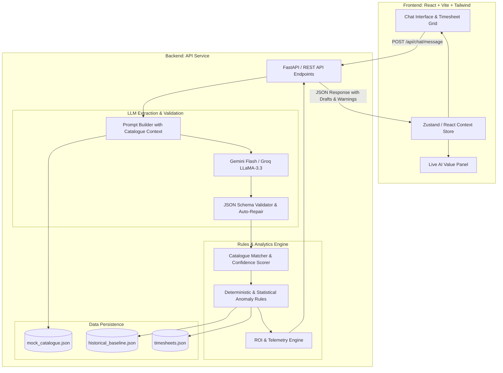

# TimeTalk: System Architecture & Data Specification

**Product:** TimeTalk — Conversational Timesheet Copilot  
**Author:** Keerttik  
**Date:** November 10, 2026  
**Document Type:** Technical Architecture, Data Schemas & Prompt Engineering Spec  
**Version:** 1.0  

---

## 1. System Architecture Overview

TimeTalk implements a **hybrid AI architecture** combining large language models (LLMs) with deterministic rules and statistical models. 

Generative AI is deployed exclusively for unstructured text comprehension (entity recognition, relative date math, intent detection), while critical business invariants (project code integrity, budget caps, closed project blocking, and statistical outlier checks) are strictly enforced by deterministic and statistical algorithms.



---

## 2. API Endpoints Specification

### 2.1 `POST /api/chat/parse`
Extracts activities from user chat text, grounds them against the catalogue, evaluates anomalies, and returns draft rows.

- **Request Payload:**
```json
{
  "conversation_id": "conv_98234",
  "user_id": "u_priya",
  "message": "Spent 3 hours on the Acme design review yesterday and 1 hour on internal standup.",
  "client_timestamp": "2026-11-10T20:00:00+05:30"
}
```

- **Response Payload:**
```json
{
  "conversation_id": "conv_98234",
  "status": "success",
  "requires_clarification": false,
  "clarification_prompt": null,
  "draft_entries": [
    {
      "id": "draft_01",
      "date": "2026-11-09",
      "project_code": "ACME-WEB",
      "project_name": "Acme Website Redesign",
      "task": "Design",
      "hours": 3.0,
      "is_billable": true,
      "confidence": 0.92,
      "reasoning": "Matched 'Acme design review' to ACME-WEB / Design (92% confidence)",
      "anomalies": []
    },
    {
      "id": "draft_02",
      "date": "2026-11-09",
      "project_code": "INT-OPS",
      "project_name": "Internal Operations",
      "task": "Standup",
      "hours": 1.0,
      "is_billable": false,
      "confidence": 0.95,
      "reasoning": "Matched 'internal standup' to INT-OPS / Standup (95% confidence)",
      "anomalies": []
    }
  ],
  "telemetry": {
    "model": "gemini-2.5-flash",
    "input_tokens": 340,
    "output_tokens": 120,
    "latency_ms": 310
  }
}
```

### 2.2 `POST /api/timesheets/confirm`
Commits verified draft rows to active timesheets.

- **Request Payload:**
```json
{
  "user_id": "u_priya",
  "entries": [
    {
      "date": "2026-11-09",
      "project_code": "ACME-WEB",
      "task": "Design",
      "hours": 3.0,
      "is_billable": true,
      "user_edited": false
    }
  ]
}
```

- **Response:** `{ "status": "committed", "count": 1 }`

---

## 3. Data Schemas & Models

### 3.1 Project Catalogue (`mock_catalogue.json`)
```typescript
interface Project {
  code: string;                 // e.g. "ACME-WEB"
  name: string;                 // e.g. "Acme Website Redesign"
  client: string;               // e.g. "Acme Corp"
  type: "billable" | "non_billable";
  is_billable: boolean;
  bill_rate: number;            // e.g. 4000 (INR/hr)
  budget_hours: number | null;  // e.g. 200
  hours_logged: number;         // e.g. 176
  budget_used_pct: number;      // e.g. 88
  tasks: string[];              // e.g. ["Design", "Development", "QA"]
  status: "active" | "closed";
  end_date?: string;            // e.g. "2026-10-31" (ISO 8601)
}
```

### 3.2 Draft Timesheet Row with Observability Trace
```typescript
interface TimesheetRow {
  id: string;
  date: string;                 // "YYYY-MM-DD"
  project_code: string;
  project_name: string;
  task: string;
  hours: number;
  is_billable: boolean;
  status: "draft" | "confirmed";
  user_edited: boolean;
  confidence: number;           // 0.0 to 1.0
  reasoning: string;
  raw_input_snippet: string;
  anomalies: AnomalyWarning[];
  trace: {
    model: string;
    tokens: number;
    latency_ms: number;
  };
}

interface AnomalyWarning {
  rule_id: "UNUSUAL_HOURS" | "WEEKEND_HOLIDAY" | "BILLABLE_INTERNAL" | "BUDGET_BURN" | "CLOSED_PROJECT" | "DUPLICATE";
  severity: "warning" | "error";
  message: string;
  suggested_fix?: {
    action: "set_non_billable" | "change_project" | "adjust_hours";
    value: any;
  };
}
```

---

## 4. Prompt Engineering & LLM Grounding Strategy

### 4.1 System Prompt Definition
```text
You are TimeTalk, an enterprise timesheet assistant for Northwind Consulting.
Your role is to parse employee work descriptions into structured JSON timesheet records.

CURRENT SYSTEM TIME: {current_date_iso} (Reference for relative dates like "yesterday", "Monday")

APPROVED PROJECT CATALOGUE:
{catalogue_json_condensed}

RULES:
1. ONLY match projects and tasks from the APPROVED PROJECT CATALOGUE. NEVER invent or hallucinate codes.
2. If the user mentions a project that is ambiguous (e.g. "Acme" when both ACME-WEB and ACME-MOB exist), set confidence < 0.80 and specify the ambiguous options.
3. Resolve relative dates accurately against the reference date.
4. Output MUST conform strictly to the specified JSON schema.
```

### 4.2 Few-Shot In-Context Demonstrations
- **Input:** *"Spent 3 hours on the Acme design review yesterday and 1 hour on internal standup."*
- **Output:**
```json
{
  "activities": [
    {
      "date": "2026-11-09",
      "hours": 3.0,
      "project_code": "ACME-WEB",
      "task": "Design",
      "is_billable": true,
      "confidence": 0.92,
      "reason": "Matched 'Acme design review' to ACME-WEB / Design"
    },
    {
      "date": "2026-11-09",
      "hours": 1.0,
      "project_code": "INT-OPS",
      "task": "Standup",
      "is_billable": false,
      "confidence": 0.95,
      "reason": "Matched 'internal standup' to INT-OPS / Standup"
    }
  ]
}
```

---

## 5. Anomaly Detection Engine (Deterministic + Statistical)

| Rule ID | Type | Computation / Invariant | Threshold & Trigger Condition | Output Warning |
| :--- | :--- | :--- | :--- | :--- |
| **UNUSUAL_HOURS** | Statistical | $Z = \frac{\text{DayTotal} - \mu}{\sigma}$ | $Z > 2.0$ ($\mu = 8.2\text{h}, \sigma = 1.1\text{h} \rightarrow >10.4\text{h}$) | *"11.0 hrs is well above your usual 8.2 hrs. Correct?"* |
| **WEEKEND_HOLIDAY** | Deterministic | Day of week $\in \{\text{Sat}, \text{Sun}\}$ or date $\in \text{Holidays}$ | Entry dated on weekend or company holiday | *"This is a [Sunday/Holiday]. Still billable?"* |
| **BILLABLE_INTERNAL** | Deterministic | `is_billable == true` AND `project.type == "non_billable"` | Non-billable project code flagged billable | *"Internal projects aren't billable. Switch to non-billable?"* |
| **BUDGET_BURN** | Deterministic | $\frac{\text{Logged} + \text{NewHours}}{\text{Budget}} > 0.90$ | Cumulative hours $> 90\%$ of project budget | *"ACME-WEB Design is at 94% of budget."* |
| **CLOSED_PROJECT** | Deterministic | `entry_date > project.end_date` | Logging against closed client code | *"This project closed on 31 Oct."* |
| **DUPLICATE** | Deterministic | Identical `(date, project_code, task)` exists | Already logged on same day and task | *"You already logged 3 hrs here today."* |

---

## 6. Real-Time ROI & Telemetry Mathematics

The live **AI Value Panel** updates after every interaction using the following transparent formulas:

```text
1. Tokens Consumed = Sum(Prompt Tokens + Completion Tokens)
2. AI Cost (₹) = (Tokens / 1,000,000) * Price_Per_Million_Tokens
3. Time Saved (min) = (Manual_Baseline_Min * Confirmed_Rows) - Chat_Duration_Min
4. Value of Time Saved (₹) = (Time_Saved_Min / 60) * Loaded_Hourly_Cost (₹1,500/hr)
5. Billing Leakage Caught (₹) = Sum(Anomalous_Hours_Recovered * Project_Bill_Rate)
6. Total Economic Value (₹) = Value of Time Saved + Billing Leakage Caught
7. Return on Investment (ROI) = Total Economic Value / AI Cost
```

### Configurable Baseline Parameters
- **Manual Logging Baseline:** $2.0$ minutes per manual entry (navigating dropdowns, dates, and descriptions).
- **Loaded Hourly Cost:** $₹1,500\text{/hr}$ (average consultant loaded rate at Northwind Consulting).
- **Gemini 2.5 Flash Pricing:** $\approx ₹0.000008$ per token ($₹8$ per million tokens).
- **Target Value-to-Cost Ratio:** $>10\times$ live demonstration target.

---

## 7. Security, Privacy & Guardrail Principles

1. **No External PII / Payroll Exposure:** Only the user prompt, date context, and sanitized project catalog are transmitted to the LLM. No consultant salary, client financial contracts, or employee personal data is sent.
2. **Drafts-Only Constraint:** The AI has zero write permissions to the master timesheet database. The sole transition from `draft` to `confirmed` requires a deliberate user click.
3. **Hard Ceiling on Ambiguity:** Any match falling below an $80\%$ cosine or heuristic similarity threshold is halted for human clarification rather than guessed.

