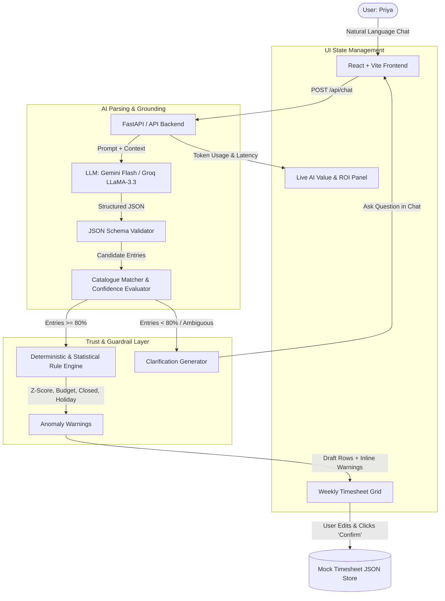

# TimeTalk: Phase-Wise Implementation Plan

**Project:** TimeTalk — Conversational Timesheet Copilot  
**Author:** Keerttik  
**Date:** November 10, 2026  
**Document Type:** Technical & Product Implementation Plan  
**Target Duration:** 3 Days (Antigravity Sprint)  

---

## 1. Overview & Architecture Blueprint

TimeTalk is designed with a **hybrid AI architecture**: an LLM handles natural language parsing, date resolution, and entity extraction into structured JSON, while a deterministic/statistical rules engine handles validation, catalogue grounding, and anomaly detection. 



### Technology Stack
- **Frontend:** React 18, Vite, Tailwind CSS, Lucide Icons, KaTeX (for mathematical ROI rendering).
- **Backend:** FastAPI (Python) or Express (Node.js fallback), Pydantic / Zod for strict JSON schema enforcement.
- **LLM / Inference:** Gemini 2.5 Flash / Groq LLaMA-3.3 with JSON mode / structured output.
- **Data Persistence:** Local JSON flat files (`mock_catalogue.json`, `historical_baseline.json`, `timesheets.json`).
- **Deployment:** Railway / Docker.

---

## 2. Phase-Wise Roadmap Summary

| Phase | Timeline | Core Focus | Key Deliverables |
| :--- | :--- | :--- | :--- |
| **Phase 0: Setup & Data Spec** | Day 0 (Pre-work) | Foundation & Seed Data | Mock catalogue, 8-week historical baseline, mock holiday, schema definitions. |
| **Phase 1: The Core Loop** | Day 1 | Natural Language to Drafts | Chat UI, structured extraction, catalogue grounding, editable weekly table, 1-click confirmation. |
| **Phase 2: The Trust Layer** | Day 2 | Guardrails & Anomaly Detection | Confidence scoring (<80% clarification questions), 6 anomaly checks, inspectable "Why?" trace. |
| **Phase 3: Value, Polish & Demo** | Day 3 | Observability, ROI & Deployment | Live AI Value Panel, assumptions modal, admin aggregates, Railway deployment, 90s demo video. |

---

## 3. Detailed Phase Breakdown

---

### Phase 0: Setup, Environment & Mock Data Specification
**Objective:** Establish the development environment, baseline datasets, and contract schemas before writing business logic.

#### Task 0.1: Environment Setup
- Initialize Git repository and directory structure:
  ```text
  TimeTalk/
  ├── backend/
  │   ├── app/
  │   │   ├── main.py
  │   │   ├── engine/
  │   │   │   ├── extractor.py
  │   │   │   ├── matcher.py
  │   │   │   └── anomalies.py
  │   │   ├── models/
  │   │   └── data/
  │   ├── requirements.txt
  │   └── .env
  ├── frontend/
  │   ├── src/
  │   │   ├── components/
  │   │   │   ├── ChatInterface.jsx
  │   │   │   ├── TimesheetGrid.jsx
  │   │   │   ├── AnomalyWarning.jsx
  │   │   │   ├── AIValuePanel.jsx
  │   │   │   └── WhyTraceModal.jsx
  │   │   ├── App.jsx
  │   │   └── mockData.js
  │   └── package.json
  ```
- Configure environment variables for LLM APIs (Gemini API key / Groq API key).

#### Task 0.2: Mock Data Seed Creation (`backend/app/data/`)
- **`mock_catalogue.json`**:
  - `ACME-WEB`: Acme Website Redesign | Tasks: *Design, Development, QA* | Type: Billable | Budget Used: 88% | Rate: ₹4,000/hr
  - `ACME-MOB`: Acme Mobile App | Tasks: *Design, Development* | Type: Billable | Budget Used: 40% | Rate: ₹4,000/hr
  - `GLOBEX-DATA`: Globex Data Migration | Tasks: *Analysis, Migration* | Type: Billable | Budget Used: 65% | Rate: ₹3,500/hr
  - `INITECH-AUD`: Initech Audit Support | Tasks: *Fieldwork* | Type: Billable (Closed on Oct 31, 2026) | Budget Used: 100% | Rate: ₹3,000/hr
  - `INT-OPS`: Internal Operations | Tasks: *Standup, Training, Admin* | Type: Non-billable | Rate: ₹0/hr
- **`historical_baseline.json`**:
  - Seed 8 weeks of daily logged hours for Priya (mean = 8.2 hrs/day, standard deviation $\sigma = 1.1$ hrs).
  - Seed 1 mock company holiday (e.g., Diwali or National Holiday on a weekday).
- **`timesheets.json`**: Active weekly state holding confirmed entries.

---

### Phase 1: Day 1 — The Core Loop
**Objective:** Deliver the fundamental user flow: Priya types a sentence, the LLM parses it into structured JSON, matches the catalogue, populates the weekly timesheet table as drafts, and allows one-click confirmation.

#### Functional Scope Covered: `FR1`, `FR2`, `FR3`, `FR5`, `FR7`

#### Task 1.1: LLM Parsing Engine (`backend/app/engine/extractor.py`)
- Implement prompt engineering with system instructions:
  - Extract: `date` (resolve relative terms like "yesterday", "Monday" relative to today's date), `hours` (decimal number), `activity_description`, `project_hint`, `task_hint`, `billable_intent`.
  - Output format: Enforce strict JSON schema response.
  - Implement retry fallback: If schema validation fails, retry once with corrective prompt; if fail twice, request user rephrase.

#### Task 1.2: Mock Catalogue Grounding & Matcher (`backend/app/engine/matcher.py`)
- Match extracted activities against `mock_catalogue.json`.
- Strict validation: LLM cannot invent project codes.
- Calculate matching confidence score ($0.0 - 1.0$) using string similarity / embedding score / fuzzy match.
- High confidence ($\ge 80\%$): Tag ready for draft table.

#### Task 1.3: Weekly Timesheet Grid & Draft Rows (`frontend/src/components/TimesheetGrid.jsx`)
- Render a weekly Monday–Sunday timesheet view for Northwind Consulting.
- Differentiate states visually:
  - **Confirmed Rows:** Solid text, badge indicating verified status.
  - **Draft Rows (Pending Review):** Highlighted/pulsing border, tag `Draft (AI generated)`, editable inline inputs (hours, project dropdown, task dropdown, billable toggle).
- Add action buttons: "Confirm All Drafts" and individual row "Confirm" / "Discard".

#### Task 1.4: Chat Interface (`frontend/src/components/ChatInterface.jsx`)
- Chat stream supporting multi-message conversational thread.
- Quick test action chips for Priya's demo inputs:
  - *"Spent 3 hours on the Acme design review yesterday and 1 hour on internal standup."*
- Display LLM response acknowledging the extraction and informing the user that drafts are ready for review.

#### Phase 1 Acceptance Gate (Day 1 Exit Criteria)
- [ ] User enters *"Spent 3 hours on the Acme design review yesterday and 1 hour on internal standup."*
- [ ] Backend returns 2 structured objects matched to `ACME-WEB (Design)` and `INT-OPS (Standup)`.
- [ ] Two draft rows appear in the weekly table under yesterday's column.
- [ ] User clicks "Confirm" $\rightarrow$ drafts convert to committed timesheet rows.
- [ ] Zero rows are committed to storage prior to user confirmation (`FR7`).

---

### Phase 2: Day 2 — The Trust Layer & Guardrails
**Objective:** Build enterprise defensibility through clarification dialogs, deterministic and statistical anomaly rules, and transparent reasoning.

#### Functional Scope Covered: `FR4`, `FR6`, `FR9`

#### Task 2.1: Ambiguity & Clarification Flow (`FR4`)
- When matching confidence is $<80\%$ or multiple candidates share equal similarity (e.g. user says *"2 hours on Acme development"* without specifying Website vs. Mobile):
  - Do NOT guess.
  - Chatbot responds with a clarifying question: *"Did you work on Acme Website (ACME-WEB) or Acme Mobile (ACME-MOB)?"*
  - Interactive clickable quick-reply chips rendered in chat.
  - Upon selection, update draft entry with selected project.

#### Task 2.2: Deterministic & Statistical Anomaly Engine (`backend/app/engine/anomalies.py` / `FR6`)
Implement the 6 hybrid anomaly checks:
1. **Unusual Daily Hours (Statistical Z-Score):**
   - Check if $\text{Daily Total} > \mu + 2\sigma$ ($8.2 + 2(1.1) = 10.4$ hrs).
   - Warning: *"11.0 hrs is well above your usual 8.2 hrs. Correct?"*
2. **Weekend or Holiday Entry:**
   - Detect if entry falls on Saturday/Sunday or mock holiday.
   - Warning: *"This date is a [Sunday/Holiday]. Still billable?"*
3. **Billable on Internal Project:**
   - Detect `is_billable == true` where project is `INT-OPS`.
   - Warning: *"Internal projects aren't billable. Switch to non-billable?"*
4. **Budget Burn Breach ($>90\%$):**
   - Detect if new hours push project past $90\%$ of allocated budget (e.g., `ACME-WEB` is already at 88%).
   - Warning: *"ACME-WEB Design is now at 94% of budget."*
5. **Closed Project Logging:**
   - Detect logging against projects with `end_date < entry_date` (`INITECH-AUD` closed Oct 31).
   - Warning: *"This project closed on 31 Oct. Time cannot be billed."*
6. **Duplicate Entry:**
   - Detect if identical project, task, and date already exist in confirmed or draft entries.
   - Warning: *"You already logged 3 hrs here today."*

#### Task 2.3: Inline Warning UI & One-Click Fixes
- Display color-coded alert badges on affected draft rows (Amber for warnings, Red for policy violations).
- Provide 1-click remediation button (e.g., "Switch to non-billable", "Reduce hours").

#### Task 2.4: Observability "Why?" Toggle (`frontend/src/components/WhyTraceModal.jsx` / `FR9`)
- Each row includes a small `Why?` button.
- Clicking opens a flyout / drawer showing:
  - Original raw text snippet: `"Acme design review"`
  - Matching rationale: `Matched to ACME-WEB / Design (confidence 92%)`
  - Model info, latency (ms), input/output token counts.
  - Active anomaly rules evaluated and their Boolean outcomes.

#### Phase 2 Acceptance Gate (Day 2 Exit Criteria)
- [ ] Entering *"2 hours on Acme development"* causes TimeTalk to ask for clarification rather than guessing.
- [ ] Entering *"4 hours on Initech fieldwork today, billable"* successfully flags closed project error.
- [ ] Clicking "Why?" on any row exposes transparent matching logic, confidence score, and token telemetry.

---

### Phase 3: Day 3 — The AI Value Panel, Polish & Demo
**Objective:** Prove cost-effectiveness in real-time, provide administrative macro-analytics, deploy to Railway, and execute the 90-second demo script.

#### Functional Scope Covered: `FR8`, `FR10`, 90s Demo Flow

#### Task 3.1: Live AI Value & ROI Panel (`frontend/src/components/AIValuePanel.jsx` / `FR8`)
- Build the real-time telemetry sidebar updating after every chat interaction:
  - **Tokens Consumed:** Cumulative input + output tokens.
  - **AI Cost (₹):** $\text{Tokens} \times \text{Price per token}$ (rendered in paise / rupees).
  - **Time Saved (mins):** $(2 \text{ min baseline} \times \text{confirmed entries}) - \text{time spent in chat}$.
  - **Value of Time Saved (₹):** $\frac{\text{Time Saved (min)}}{60} \times ₹1,500\text{/hr}$.
  - **Billing Leakage Caught (₹):** $\text{Anomalies caught (hrs)} \times \text{Project Bill Rate}$.
  - **Live ROI:**
    $$\text{ROI} = \frac{\text{Value of Time Saved} + \text{Billing Leakage Caught}}{\text{AI Cost}}$$
- Include an expandable **"Assumptions" Drawer** displaying loaded rates ($₹1,500$/hr), manual baseline ($2$ mins/entry), and model pricing.

#### Task 3.2: Admin Macro View Modal (`FR10`)
- Aggregated dashboard tab summarizing all demo conversations:
  - Total conversations conducted.
  - Net cost vs. net value created.
  - Edit rate: $\frac{\text{Confirmed rows edited by user}}{\text{Total confirmed rows}}$ (quality benchmark).

#### Task 3.3: Railway Deployment & Environment Config
- Create `Dockerfile` or `Procfile` for Railway container deployment.
- Verify production environment variables (`GEMINI_API_KEY`, `CORS_ORIGINS`, `PORT`).
- Conduct health-check verification on the public Railway URL.

#### Task 3.4: 90-Second Demo Rehearsal & Screen Recording
Execute the 5-step narrative specified in the PRD:
1. **Speed Test:** Send *"Spent 3 hours on the Acme design review yesterday and 1 hour on standup."* (Two correct rows populated in <5s).
2. **Precision & Safety:** Send *"2 hours on Acme development."* (System prompts: Website or Mobile? Proves no guessing).
3. **Leakage Protection:** Send *"4 hours on Initech fieldwork today, billable."* (Inline warning: Closed project on Oct 31).
4. **Observability:** Click **"Why?"** on the Acme row to display confidence ($92\%$) and reasoning trail.
5. **ROI Justification:** Finish on the **AI Value Panel** displaying live cost in paise, time saved, and ROI $>10\times$.

---

## 4. Work Breakdown Structure (WBS) & Effort Estimates

| Workstream | Sub-Tasks | Estimated Hours |
| :--- | :--- | :--- |
| **Data & Architecture** | Mock datasets (`catalogue`, `baseline`), JSON schemas, project structure | 2.5 hrs |
| **Backend & LLM** | FastAPI setup, extraction prompt, JSON validator, catalogue matcher | 5.0 hrs |
| **Trust Engine** | 6 anomaly rules, z-score statistical calculation, ambiguity detector | 4.5 hrs |
| **Frontend UI** | Weekly timesheet grid, chat interface, editable draft rows, alert badges | 6.0 hrs |
| **Telemetry & ROI** | AI Value Panel calculations, assumptions modal, "Why?" trace drawer | 3.5 hrs |
| **Deployment & Demo** | Railway configuration, end-to-end bug bash, 90-second recording | 2.5 hrs |
| **Total Effort** | | **24 hrs (~3 Days)** |

---

## 5. Risk Assessment & Mitigation Matrix

| Risk Event | Severity | Likelihood | Mitigation Strategy |
| :--- | :--- | :--- | :--- |
| **LLM Output Formatting Failure** | High | Low | Enforce strict Pydantic / Zod schema validation; implement single automatic retry with error feedback before asking user to rephrase. |
| **Catalogue Hallucination** | Critical | Low | Reject any project/task code not present in `mock_catalogue.json`. Hard fallback to clarification prompt if similarity $<80\%$. |
| **Negative Time Saved Calculation** | Medium | Medium | In short tests with long chats, time spent in chat could exceed manual baseline. Calibrate chat timer to start on first keystroke and pause between user responses. |
| **Local Python Environment Missing** | Low | High | Use Node.js/Express backend or containerize via Docker/Railway so local runtime discrepancies are non-blocking. |

---

## 6. Definition of Done (DoD)

A phase is considered complete when:
1. All functional requirements tagged to that phase pass automated or manual test scripts.
2. The UI renders without console errors and adheres to Northwind Consulting mock branding.
3. Every anomaly check produces the documented warning message when triggered.
4. The 90-second demo script executes without unexpected prompts or failures.

