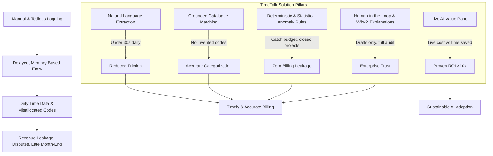

# Problem Statement: TimeTalk — Conversational Timesheet Copilot

**Author:** Keerttik  
**Date:** November 10, 2026  
**Context:** Professional Services & Consulting Time Tracking  
**Document Type:** Product Problem Statement & Opportunity Assessment  

---

## 1. Executive Summary

In professional services firms (consulting, agencies, legal, IT services), time is inventory and revenue. Every hour logged directly feeds client billing, project costing, resource utilization, and payroll. 

Despite its financial criticality, **timesheet logging is treated by employees as an administrative chore**. Employees log time late, rely on memory, and struggle with multi-level project/task dropdowns. The resulting dirty time data causes severe downstream financial leakage: unbilled hours, misfiled client codes, billing disputes, and protracted month-end closing cycles.

Furthermore, naive implementations of AI chatbots fail to resolve this because enterprise leadership lacks trust in non-deterministic systems modifying core billing data without verification, explainability, and proven return on investment (ROI).

**TimeTalk** addresses this breakdown through a conversational, human-in-the-loop copilot that turns natural language into validated timesheet entries in under 30 seconds, catches billing anomalies before submission, explains its reasoning, and live-proves its ROI per interaction.

---

## 2. Background & Market Context

Professional services organizations operate on billable utilization. Accurate, timely tracking of hours is the single most vital input for:
- **Revenue Recognition & Invoicing:** Billing clients accurately for work delivered.
- **Project Budgeting & Margin Protection:** Tracking real-time burn against project and task budgets.
- **Resource Management & Capacity Planning:** Understanding actual consultant workloads and capacity.
- **Compliance & Payroll:** Accurate records for labor regulations and compensation.

Yet, traditional time-tracking software forces knowledge workers into rigid, dropdown-heavy web forms requiring manual project codes, task selections, and date lookups.

---

## 3. The Core Problem

### 3.1 Cognitive Overload & Behavioral Resistance
- **Administrative Friction:** Navigating nested project hierarchies and ambiguous task dropdowns takes ~4 minutes per day.
- **End-of-Week Batch Logging:** Because daily logging is tedious, employees batch their entries on Friday afternoons or end-of-month deadlines.
- **Memory Decay & Inaccurate Allocation:** Reconstructing 40+ hours from memory leads to vague descriptions, rounded estimates, and misallocated project codes.

### 3.2 Downstream Business & Financial Leakage
- **Unbilled Hours:** Forgotten hours are never captured or invoiced, directly leaking firm revenue.
- **Misallocated Costs:** Billing billable hours to internal codes (or non-billable hours to client codes) distorts project margins.
- **Invoice Disputes & Write-offs:** Clients reject vague or miscoded invoices, requiring lengthy manual reconciliations and write-offs.
- **Delayed Month-End Close:** Project managers and finance teams spend days chasing missing timesheets and auditing anomalies.

### 3.3 The Enterprise AI Trust Gap
Adding a conventional GenAI chatbot does not automatically solve the problem:
- **Hallucination Risk:** Generative AI can hallucinate project codes or invent non-existent tasks.
- **Lack of Verification:** Unchecked automation writing directly to billing databases introduces compliance and accounting liabilities.
- **The "Black Box" Problem:** Users and managers will not trust an AI's classifications without transparent reasoning and confidence scores.
- **Unjustified AI Spend:** Enterprise leaders are skeptical of GenAI costs and need visible proof that the model saves more money than it consumes.

---

## 4. Stakeholder & Persona Analysis

| Persona | Role | Core Pain Points Today | Desired Outcome with TimeTalk |
| :--- | :--- | :--- | :--- |
| **Priya** *(Primary)* | Consultant | • Logs time late Friday afternoon entirely from memory • Spends ~4 minutes hunting through project and task dropdowns • Experiences friction matching work items to codes | • Types natural sentences (e.g., *"Spent 3 hours on Acme design review"*). • Pre-filled draft rows appear in seconds with 1-click confirmation. • Saves ~3.5 minutes per day. |
| **Arjun** | Project Manager | • Constantly chases consultants for missing timesheets • Manually audits misfiled hours and budget burns before invoicing • Resolves client pushback on inaccurate billings | • Anomaly rules flag errors (closed projects, budget caps) *before* submission. • Vastly fewer corrections and smoother invoicing cycles. |
| **Finance / Billing Lead** | Finance Operations | • High volume of unbilled hours, invoice disputes, and write-offs • Protracted month-end financial close due to delayed time submissions | • Clean, grounded billable data with verified audit trails. • Minimal write-offs and predictable month-end close. |
| **AI Program Owner** | Enterprise Tech Leader | • Pressured by executive leadership to justify generative AI spend • Struggles to measure tangible ROI and productivity impact of AI initiatives | • Live **AI Value Panel** displaying token usage, exact API costs, time saved, and real-time ROI (>10x). |

---

## 5. Problem Breakdown & Solution Hypotheses

### Key Hypotheses
1. **Speed & UX:** If consultants can log multiple activities across multiple days via a single natural-language sentence, logging time will drop from ~4 minutes to under 30 seconds, drastically reducing batch logging.
2. **Grounding & Guardrails:** If the LLM is strictly restricted to an approved project catalogue and explicitly asks clarifying questions when confidence is below 80%, code invention and misallocation will drop to near zero.
3. **Hybrid AI Architecture (GenAI + Traditional ML/Rules):** LLMs excel at unstructured parsing, but deterministic rules (e.g., closed project checks, budget overruns) and statistical checks (e.g., z-score daily hour anomalies) provide predictable, cheap, and auditable anomaly prevention.
4. **Human-in-the-Loop Safety:** If AI only creates editable drafts and requires explicit user confirmation, enterprise risk is eliminated.
5. **Real-time Value Observability:** If cost per message and economic value created (time saved + revenue protected) are shown live, stakeholders will readily embrace and fund AI adoption.

---

## 6. Success Metrics & Key Performance Indicators (KPIs)

| Dimension | Target Metric / KPI | Baseline (Status Quo) | Demo / Target Goal |
| :--- | :--- | :--- | :--- |
| **Speed** | Time to log a full day's activities | ~4 minutes (manual form) | **< 30 seconds** (chat copilot) |
| **Accuracy** | Timesheet entries confirmed without user edits | Variable / low | **≥ 90%** on standard inputs |
| **Safety** | Entries submitted directly to timesheet without user review | N/A | **0** (Drafts only; 100% human confirmation) |
| **Leakage Prevention** | Seeded billing anomalies caught before submission | Dependent on manual audit | **100%** of seeded anomalies flagged |
| **Trust & Observability** | Output entries with inspectable reasoning & confidence | 0% (black box) | **100%** coverage via "Why?" trace |
| **Value & ROI** | Value-to-cost ratio per conversation | Unmeasured | **> 10x ROI** displayed live in UI |

---

## 7. Out of Scope for Initial Scope

To keep the initial focus sharp on validating the core value proposition (speed, accuracy, trust, and live ROI), the following are intentionally deferred:
- Full production authentication / SSO integration.
- Bidirectional synchronization with legacy ERPs (e.g., SAP, Workday, NetSuite).
- Multi-tier manager approval workflows.
- Payroll processing and disbursement integrations.
- Native mobile applications and voice input.

