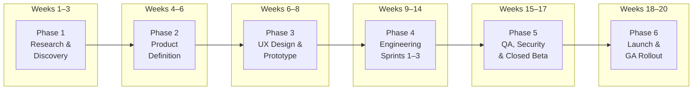

# TimeTalk: 0-to-1 Product Timeline — Research to Delivery

**Product:** TimeTalk — Conversational Timesheet Copilot  
**Author:** Keerttik  
**Date:** November 10, 2026  
**Document Type:** Full Product Lifecycle Timeline (0 → 1)  
**Total Duration:** ~20 Weeks (5 Months)  
**Assumed Team:** 1 PM, 1 Product Designer, 2 Full-Stack Engineers, 1 ML/AI Engineer, 1 QA  

---

## Executive Timeline View

---

## Phase 1: Research & Discovery (Weeks 1–3)

**Goal:** Validate the problem exists at painful-enough intensity to justify a new product. Understand who hurts most, how much it costs them, and what they've already tried.

### Week 1: Market Landscape & Competitive Audit

| Day | Activity | Deliverable |
|:---:|:---|:---|
| 1–2 | **Secondary research:** Industry reports on professional services billing leakage (SPI Research, Deltek benchmarks, Kantata/Mavenlink State of PS reports). Quantify market size (TAM/SAM/SOM). | Market sizing one-pager |
| 3–4 | **Competitive teardown:** Evaluate existing time-tracking tools (Harvest, Toggl, Clockify, Replicon, SAP Concur, Workday Time Tracking). Map features, pricing, and gaps. Test any AI-powered entrants. | Competitive matrix spreadsheet |
| 5 | **Internal desk research:** Audit published user complaints (G2, Capterra reviews, Reddit r/consulting, Blind). Extract recurring pain themes. | Pain-theme affinity board |

### Week 2: Primary User Research — Interviews & Contextual Inquiry

| Day | Activity | Deliverable |
|:---:|:---|:---|
| 1 | **Recruit participants:** Source 8–12 users across 3 personas: Consultants (5–6), Project Managers (2–3), Finance/Billing Leads (2–3). Use LinkedIn outreach, professional Slack communities, and personal network. | Participant roster & screener |
| 2–4 | **Conduct semi-structured interviews (45 min each):** Observe actual timesheet workflows (screen-share), measure time-to-complete, capture emotional friction points, probe workarounds used, and test appetite for AI-assisted logging. | Raw interview transcripts & recordings |
| 5 | **Stakeholder interview:** 1–2 sessions with enterprise IT/AI program owners on AI trust barriers, compliance constraints, and ROI justification pressure. | Executive needs summary |

### Week 3: Synthesis & Problem Validation

| Day | Activity | Deliverable |
|:---:|:---|:---|
| 1–2 | **Affinity mapping & thematic coding:** Cluster interview insights into problem themes. Prioritize by frequency × severity. | Affinity map (Miro/FigJam board) |
| 3 | **Jobs-To-Be-Done (JTBD) framing:** Define core functional, emotional, and social jobs for each persona. | JTBD canvas per persona |
| 4 | **Quantitative validation survey:** Deploy a short survey (n=50–100) to the broader target population validating top pain points and willingness-to-pay signals. | Survey results dashboard |
| 5 | **Research readout & Go/No-Go decision:** Present findings to stakeholders. Confirm problem-solution fit hypothesis. | Research readout deck (10 slides) |

> [!IMPORTANT]
> **Phase 1 Gate:** Proceed only if ≥70% of interviewed consultants confirm weekly timesheet friction ≥ moderate severity, AND at least 2 finance/PM stakeholders confirm measurable billing leakage from dirty time data.

---

## Phase 2: Product Definition (Weeks 4–6)

**Goal:** Translate validated research into a precise product spec — scope the MVP, define success metrics, and align the team on what to build and what to defer.

### Week 4: Problem Statement, Personas & Strategy

| Day | Activity | Deliverable |
|:---:|:---|:---|
| 1 | **Formalize Problem Statement:** Distill research into a crisp problem statement document with stakeholder pain quantification. | [`problemstatement.md`](file:///D:/Product%20Management%20job%20in%203%20months/TimeTalk/problemstatement.md) |
| 2–3 | **Persona development:** Build detailed persona cards for Priya (Consultant), Arjun (PM), Finance Lead, and AI Program Owner — each with context, goals, frustrations, and success metrics. | Persona cards (4 personas) |
| 4 | **Product vision & strategy one-pager:** Define the north-star vision, strategic positioning (hybrid AI = speed of GenAI + trust of deterministic rules), and differentiation thesis against incumbents. | Product strategy one-pager |
| 5 | **Opportunity sizing & business case:** Model revenue potential (SaaS per-seat pricing × target market), estimate development cost, and project break-even timeline. | Business case spreadsheet |

### Week 5: PRD, User Stories & Acceptance Criteria

| Day | Activity | Deliverable |
|:---:|:---|:---|
| 1–2 | **Write the Product Requirements Document (PRD):** Functional requirements (FR1–FR10), non-functional requirements, scope boundaries, success KPIs, and risk register. | PRD document (already exists as source PDF) |
| 3–4 | **Break down into User Stories with Gherkin acceptance criteria:** Cover all 5 epics — Conversational Capture, Ambiguity Resolution, Timesheet Review, Anomaly Detection, and Observability/ROI. | [`user_stories.md`](file:///D:/Product%20Management%20job%20in%203%20months/TimeTalk/user_stories.md) |
| 5 | **Prioritization (MoSCoW or RICE):** Rank all user stories. Define the hard MVP boundary: what ships in v1.0 vs. what's deferred to v1.1+. | Prioritized backlog (Jira/Linear) |

### Week 6: Architecture & Technical Specification

| Day | Activity | Deliverable |
|:---:|:---|:---|
| 1–2 | **System architecture design:** Define the hybrid AI pipeline — LLM extraction layer, catalogue grounding, deterministic anomaly engine, and telemetry/ROI calculator. API endpoint contracts, data schemas, and prompt engineering strategy. | [`architecture.md`](file:///D:/Product%20Management%20job%20in%203%20months/TimeTalk/architecture.md) |
| 3 | **Tech stack decision & spike:** Evaluate LLM options (Gemini Flash vs. Groq LLaMA vs. OpenAI GPT-4o-mini) on latency, cost, structured output reliability, and JSON schema adherence. Run benchmark spike. | Tech decision record (ADR) |
| 4 | **Data specification:** Define mock catalogue schema, historical baseline seed format, and timesheet persistence model. Create seed data files. | [`mock_catalogue.json`](file:///D:/Product%20Management%20job%20in%203%20months/TimeTalk/backend/data/mock_catalogue.json), [`historical_baseline.json`](file:///D:/Product%20Management%20job%20in%203%20months/TimeTalk/backend/data/historical_baseline.json) |
| 5 | **Sprint planning & estimation:** Break architecture into engineering tasks, estimate story points, and plan 3 two-week sprints. | Sprint plan (Jira/Linear board) |

> [!IMPORTANT]
> **Phase 2 Gate:** PRD signed off by product lead. Architecture reviewed by engineering lead. Backlog groomed and Sprint 1 ready to begin.

---

## Phase 3: UX Design & Interactive Prototype (Weeks 6–8, overlapping with late Phase 2)

**Goal:** Design a high-fidelity interactive prototype, validate it with real users before writing production code, and establish the design system.

### Week 6–7: Information Architecture, Wireframes & Interaction Design

| Day | Activity | Deliverable |
|:---:|:---|:---|
| 1–2 | **Information architecture (IA):** Map the screen hierarchy — Chat Panel, Weekly Timesheet Grid, AI Value Sidebar, Why? Trace Drawer, Settings/Assumptions Modal. Define navigation flows. | IA sitemap & flow diagram |
| 3–5 | **Low-fidelity wireframes:** Sketch key screens: (1) Empty state with onboarding prompt, (2) Chat mid-conversation with draft rows populating, (3) Anomaly warning inline on grid row, (4) Why? flyout panel, (5) AI Value Panel expanded, (6) Clarification quick-reply chips in chat. | Wireframe set (Figma/Whimsical) |
| 6–8 | **High-fidelity UI mockups:** Apply visual design system — Northwind Consulting branding, color palette (amber for drafts, green for confirmed, red for violations), typography, and component library (buttons, chips, cards, badges). | Hi-fi Figma mockups (all screens) |
| 9–10 | **Interactive Figma prototype:** Wire click-through flows covering the 5 demo scenarios (speed test, ambiguity, closed project, Why?, ROI panel). | Clickable Figma prototype URL |

### Week 8: Usability Testing & Design Iteration

| Day | Activity | Deliverable |
|:---:|:---|:---|
| 1–2 | **Recruit 5 usability test participants** (subset of Week 2 interviewees or new consultants). | Participant schedule |
| 3–4 | **Moderated usability testing (30 min each):** Task-based scenarios using the Figma prototype. Measure task completion rate, time-on-task, error rate, and SUS (System Usability Scale) score. | Usability test report |
| 5 | **Design iteration:** Fix critical usability issues (navigation confusion, label ambiguity, warning visibility). Update Figma master and component library. | Revised Figma file + design handoff spec |

> [!IMPORTANT]
> **Phase 3 Gate:** Prototype achieves ≥80% task completion rate and SUS score ≥68 (above-average usability). Critical interaction patterns validated. Design handoff spec ready for engineering.

---

## Phase 4: Engineering Build — 3 Sprints (Weeks 9–14)

**Goal:** Build the production-grade application across 3 two-week sprints, each delivering a shippable increment.

### Sprint 1 (Weeks 9–10): The Core Loop — Chat to Drafts

**Sprint Goal:** A user can type a natural language sentence and see correctly-matched draft timesheet rows appear in the weekly grid.

| Task | Owner | Story Points | Details |
|:---|:---:|:---:|:---|
| FastAPI project scaffold + CORS + health check | Backend | 2 | Project structure, Docker config, environment variable management |
| Pydantic models for catalogue, entries, API contracts | Backend | 3 | Strict typing matching [`architecture.md`](file:///D:/Product%20Management%20job%20in%203%20months/TimeTalk/architecture.md) schemas |
| LLM extraction engine with prompt + JSON schema enforcement | AI/ML | 8 | System prompt, few-shot examples, date resolution, schema validation with auto-retry |
| Catalogue matcher with confidence scoring | AI/ML | 5 | Fuzzy/embedding matching against `mock_catalogue.json`, confidence threshold logic |
| React + Vite + Tailwind project scaffold | Frontend | 2 | Component structure, routing, state management setup |
| Chat Interface component | Frontend | 5 | Message thread, input bar, quick-action sample chips, loading states |
| Weekly Timesheet Grid component | Frontend | 8 | Mon–Sun columns, draft vs. confirmed row styling, inline edit fields (hours, project dropdown, task dropdown, billable toggle) |
| Confirm / Discard draft actions + persistence | Full-stack | 5 | POST /api/timesheets/confirm, state transitions, optimistic UI updates |
| **Sprint 1 Total** | | **38 SP** | |

**Sprint 1 Demo:** Type *"3 hours on Acme design review yesterday and 1 hour on standup"* → 2 draft rows appear → click Confirm → rows committed.

---

### Sprint 2 (Weeks 11–12): The Trust Layer — Guardrails & Explainability

**Sprint Goal:** The system catches seeded anomalies, asks clarifying questions when ambiguous, and exposes reasoning through the "Why?" trace.

| Task | Owner | Story Points | Details |
|:---|:---:|:---:|:---|
| Ambiguity detection + clarification chat flow | AI/ML | 5 | Confidence < 80% triggers clarification; quick-reply pills in chat; re-match on selection |
| Anomaly rule: Unusual daily hours (z-score) | Backend | 3 | Statistical check: $Z = (\text{total} - 8.2) / 1.1 > 2.0$ |
| Anomaly rule: Weekend / holiday detection | Backend | 2 | Day-of-week check + holiday list lookup |
| Anomaly rule: Billable on internal project | Backend | 2 | Cross-reference `is_billable` flag vs. project type |
| Anomaly rule: Budget burn > 90% | Backend | 3 | Cumulative hours check against project budget |
| Anomaly rule: Closed project guard | Backend | 2 | Compare entry date against `project.end_date` |
| Anomaly rule: Duplicate entry detection | Backend | 2 | Match (date, project, task) against existing entries |
| Inline warning badges + 1-click fix actions on grid | Frontend | 5 | Amber (warning) and red (error) badges, suggested fix buttons |
| "Why?" trace drawer component | Frontend | 5 | Slide-over panel: raw input, match rationale, confidence, tokens, latency, anomaly rule evaluations |
| **Sprint 2 Total** | | **29 SP** | |

**Sprint 2 Demo:** Type *"2 hours on Acme development"* → clarification asked → select Mobile → draft created. Type *"4 hours on Initech fieldwork today, billable"* → red warning: closed project. Click "Why?" → full trace visible.

---

### Sprint 3 (Weeks 13–14): Value Layer, Polish & Integration Hardening

**Sprint Goal:** Live ROI telemetry, admin aggregates, error handling hardening, performance optimization, and deployment pipeline.

| Task | Owner | Story Points | Details |
|:---|:---:|:---:|:---|
| AI Value Panel — live telemetry calculations | Full-stack | 5 | Cumulative tokens, cost, time saved, leakage caught, ROI formula |
| Assumptions drawer (editable baseline params) | Frontend | 3 | Manual baseline (2 min), hourly rate (₹1,500), model pricing — user can override |
| Admin macro view — aggregate session dashboard | Full-stack | 5 | Total conversations, net cost vs. value, edit rate metric |
| Error boundary & graceful degradation | Frontend | 3 | LLM timeout fallback, API error toasts, retry prompts |
| Loading states, skeleton screens, transitions | Frontend | 3 | Smooth UX polish across all components |
| Prompt tuning & edge-case hardening | AI/ML | 5 | Test with 30+ varied input phrasings, multi-day entries, decimal hours, abbreviations |
| API rate limiting, input sanitization, logging | Backend | 3 | Production-readiness hardening |
| Docker containerization & CI pipeline | DevOps | 3 | Dockerfile, docker-compose, GitHub Actions CI |
| Railway / Cloud deployment + env config | DevOps | 2 | Production deploy, SSL, domain, health monitoring |
| **Sprint 3 Total** | | **32 SP** | |

**Sprint 3 Demo:** Full 90-second demo flow executes end-to-end on deployed URL with live ROI > 10×.

> [!IMPORTANT]
> **Phase 4 Gate:** All 10 functional requirements (FR1–FR10) pass acceptance criteria. Deployed application accessible via public URL. 90-second demo script executes without failures.

---

## Phase 5: QA, Security Review & Closed Beta (Weeks 15–17)

**Goal:** Rigorous quality assurance, security hardening, and validation with real users in a controlled beta environment.

### Week 15: Structured QA & Test Automation

| Day | Activity | Deliverable |
|:---:|:---|:---|
| 1–2 | **Test plan creation:** Define test cases covering all acceptance criteria from [`user_stories.md`](file:///D:/Product%20Management%20job%20in%203%20months/TimeTalk/user_stories.md). Include happy paths, edge cases, error scenarios, and adversarial inputs. | Test case suite (50+ cases) |
| 3–4 | **Manual exploratory testing:** QA engineer executes full test suite. File bugs with severity ratings. | Bug tracker (Jira/Linear) with prioritized defect list |
| 5 | **Automated regression tests:** Write API integration tests (pytest) and critical UI flow tests (Playwright/Cypress) for the 5 demo scenarios. | CI-integrated test suite |

### Week 16: Security, Privacy & Prompt Injection Review

| Day | Activity | Deliverable |
|:---:|:---|:---|
| 1–2 | **Prompt injection testing:** Attempt adversarial inputs designed to override system instructions, extract the catalogue, or generate unauthorized project codes. | Prompt injection test report |
| 3 | **Data privacy audit:** Verify no PII, salary data, or client financial details are transmitted to the LLM. Review API logging for sensitive data leakage. | Privacy audit checklist |
| 4 | **Input sanitization & XSS review:** Test for cross-site scripting via chat input, script injection in project descriptions, and SQL/NoSQL injection (if applicable). | Security review report |
| 5 | **Bug fix sprint:** Address all critical (P0) and high (P1) defects from QA and security reviews. | Clean build with 0 P0/P1 open bugs |

### Week 17: Closed Beta with Real Users

| Day | Activity | Deliverable |
|:---:|:---|:---|
| 1 | **Beta recruitment:** Invite 10–15 users from research participant pool (mix of consultants, PMs, finance leads). Provide onboarding guide and feedback form. | Beta cohort roster & onboarding doc |
| 2–4 | **Monitored beta period (3 days):** Users log real (or realistic simulated) timesheets using TimeTalk. Monitor error logs, LLM latency, anomaly trigger rates, and confirmation-without-edit rates. | Beta telemetry dashboard |
| 5 | **Beta feedback synthesis:** Collect NPS, SUS scores, and qualitative feedback. Identify top 3 friction points. Prioritize fixes for launch. | Beta feedback report & fix list |

> [!IMPORTANT]
> **Phase 5 Gate:** 0 critical bugs open. Prompt injection attacks neutralized. Beta NPS ≥ 30. First-pass accuracy (confirmed without edit) ≥ 85%. All seeded anomalies caught at 100%.

---

## Phase 6: Launch Preparation & General Availability (Weeks 18–20)

**Goal:** Prepare go-to-market assets, execute a controlled rollout, and establish the post-launch feedback loop.

### Week 18: Go-To-Market & Launch Assets

| Day | Activity | Deliverable |
|:---:|:---|:---|
| 1 | **Product positioning & messaging:** Finalize tagline, value propositions for each persona, and competitive differentiation one-liner. | Messaging framework document |
| 2 | **Landing page & product website:** Design and deploy a product page with hero demo GIF, feature breakdown, persona-specific value props, and waitlist/signup CTA. | Live landing page URL |
| 3 | **Demo video production:** Record and edit the 90-second demo walkthrough per [`demo_script.md`](file:///D:/Product%20Management%20job%20in%203%20months/TimeTalk/demo_script.md). Add voiceover, captions, and branding. | Published demo video (Loom/YouTube) |
| 4 | **Documentation & help center:** Write user-facing docs: Getting Started guide, FAQ, API docs (if applicable), and known limitations. | Help center / docs site |
| 5 | **Internal launch readiness review:** Final go/no-go with eng, design, and leadership. Confirm monitoring, on-call, and rollback plan. | Launch readiness checklist ✅ |

### Week 19: Controlled Rollout (Soft Launch)

| Day | Activity | Deliverable |
|:---:|:---|:---|
| 1 | **Soft launch to 1–2 pilot firms (or internal team):** Enable production access for a small cohort. Feature flag for gradual rollout. | Pilot deployment live |
| 2–4 | **Monitor & triage:** Watch real-time dashboards for error rates, LLM latency spikes, anomaly false-positive rates, and user drop-off in chat flow. Hot-fix any P0 issues within 4 hours. | Incident log & hotfix changelog |
| 5 | **Pilot retrospective:** Gather pilot firm feedback. Calculate real-world accuracy, time saved, and ROI metrics against the target KPIs. | Pilot results report |

### Week 20: General Availability & Post-Launch

| Day | Activity | Deliverable |
|:---:|:---|:---|
| 1 | **Public launch announcement:** Blog post, social media (LinkedIn, X/Twitter), Product Hunt launch, and email to waitlist. | Launch comms published |
| 2–3 | **Community & support setup:** Activate support channel (Intercom, Discord, or email), monitor initial user onboarding friction, and respond to early feedback. | Support triage process live |
| 4–5 | **Post-launch metrics review (Week 1 data):** First-pass accuracy rate, daily active users, median session duration, anomaly detection rate, ROI distribution across users. Identify v1.1 priorities. | Post-launch analytics dashboard |

> [!IMPORTANT]
> **Phase 6 Gate (GA Success Criteria):**
> - Uptime ≥ 99.5% in first week.
> - Median time-to-log < 30 seconds.
> - First-pass accuracy ≥ 90%.
> - 0 users report fabricated project codes (hallucination).
> - NPS ≥ 40 from first 50 respondents.

---

## 7. Post-Launch Roadmap (v1.1+ Backlog)

Items intentionally deferred from v1.0, prioritized for subsequent releases:

| Priority | Feature | Target Release | Rationale |
|:---:|:---|:---:|:---|
| P1 | **Calendar & meeting integration** (Google Calendar, Outlook) — auto-suggest entries from meeting titles | v1.1 (Week 24) | Highest-requested feature in research interviews |
| P1 | **Slack / Teams bot interface** — log time without leaving messaging apps | v1.1 (Week 24) | Meets users where they already work |
| P2 | **Manager approval workflow** — PM review & approve before final submission | v1.2 (Week 28) | Required for enterprise compliance in larger firms |
| P2 | **ERP bidirectional sync** (SAP, Workday, NetSuite) — push confirmed entries to source of record | v1.2 (Week 28) | Critical for enterprise adoption beyond standalone use |
| P3 | **Voice input** — speech-to-timesheet via mobile app or web microphone | v1.3 (Week 32) | High convenience, lower immediate demand |
| P3 | **Multi-language support** — non-English natural language input | v1.3 (Week 32) | Important for global consulting firms |
| P4 | **SSO / SAML authentication** | v1.2 (Week 28) | Enterprise IT procurement requirement |
| P4 | **Custom anomaly rule builder** — PMs define their own validation rules | v2.0 (Week 36) | Power-user feature for large deployments |

---

## 8. Team & RACI Matrix

| Role | Phase 1 | Phase 2 | Phase 3 | Phase 4 | Phase 5 | Phase 6 |
|:---|:---:|:---:|:---:|:---:|:---:|:---:|
| **Product Manager** | **R** (Lead) | **R** (Lead) | C | A | C | **R** (Lead) |
| **Product Designer** | C | C | **R** (Lead) | C | I | C |
| **Full-Stack Eng 1** | I | C | C | **R** | **R** | C |
| **Full-Stack Eng 2** | I | I | I | **R** | **R** | C |
| **AI/ML Engineer** | I | C (Tech spike) | I | **R** | **R** | C |
| **QA Engineer** | I | I | I | C | **R** (Lead) | C |

*R = Responsible, A = Accountable, C = Consulted, I = Informed*

---

## 9. Key Risks & Mitigation

| # | Risk | Impact | Probability | Mitigation |
|:---:|:---|:---:|:---:|:---|
| 1 | **LLM structured output unreliable** — schema violations, hallucinated fields | High | Medium | Strict Pydantic validation + auto-retry with error feedback. Benchmark 3+ models in tech spike (Week 6). |
| 2 | **Low user research participation** — can't recruit enough consultants | Medium | Medium | Offer incentives (gift cards). Tap personal network and LinkedIn. Lower threshold to 6 interviews minimum. |
| 3 | **Enterprise procurement friction** — SSO/compliance requirements block pilot | High | Low | Position v1.0 as team-level tool (no SSO needed). Add SSO in v1.2 roadmap. |
| 4 | **Scope creep during sprints** — feature requests from beta users expand scope | Medium | High | Strict MVP boundary enforced via MoSCoW. All new requests go to v1.1 backlog unless P0 severity. |
| 5 | **LLM cost exceeds ROI at scale** — high-volume users erode margins | Medium | Low | Use cheapest viable model (Gemini Flash / Groq). Cache repeated catalogue lookups. Monitor cost-per-session live. |
| 6 | **Negative time-saved in short sessions** — chat overhead exceeds manual for 1-entry logs | Low | Medium | Optimize for multi-activity compound inputs. Show "batch logging" tips in onboarding. |

---

## 10. Milestone Summary & Calendar View

| Milestone | Target Date | Week | Key Outcome |
|:---|:---:|:---:|:---|
| **M1: Research Complete** | Week 3, Friday | W3 | Problem validated, Go/No-Go approved |
| **M2: PRD & Backlog Signed Off** | Week 6, Friday | W6 | PRD, user stories, architecture, sprint plan locked |
| **M3: Prototype Validated** | Week 8, Friday | W8 | Hi-fi Figma tested with users, SUS ≥ 68 |
| **M4: Sprint 1 — Core Loop Demo** | Week 10, Friday | W10 | Chat → Drafts → Confirm working end-to-end |
| **M5: Sprint 2 — Trust Layer Demo** | Week 12, Friday | W12 | All 6 anomaly rules + clarification + Why? trace |
| **M6: Sprint 3 — Full Product Demo** | Week 14, Friday | W14 | AI Value Panel, polish, deployed to cloud |
| **M7: QA & Security Sign-Off** | Week 16, Friday | W16 | 0 P0/P1 bugs, prompt injection mitigated |
| **M8: Beta Complete** | Week 17, Friday | W17 | Beta NPS ≥ 30, accuracy ≥ 85% |
| **M9: Soft Launch (Pilot)** | Week 19, Friday | W19 | 1–2 firms using in production |
| **M10: General Availability** | Week 20, Monday | W20 | Public launch, Product Hunt, marketing live |

